<p align="center">
  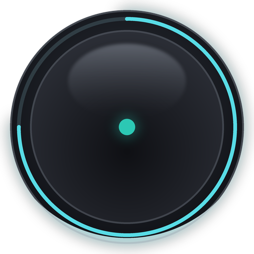
</p>

<h1 align="center">Tack</h1>

<p align="center">
  A tiny, always-on-top home for what you're doing <em>right now</em>.<br/>
  Tasks and quick notes in a frosted-glass panel that folds into a 40-pixel orb, on Windows,<br/>
  with <a href="https://tackfocus.app">Tack Focus</a> on your phone.
</p>

<p align="center">
  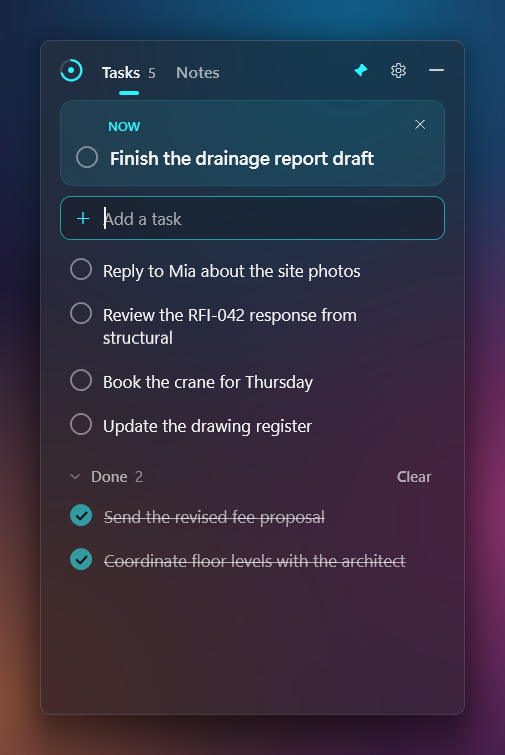
  &nbsp;
  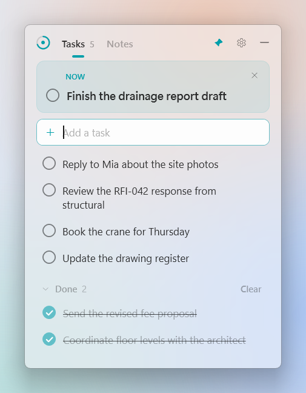
</p>
<p align="center">
  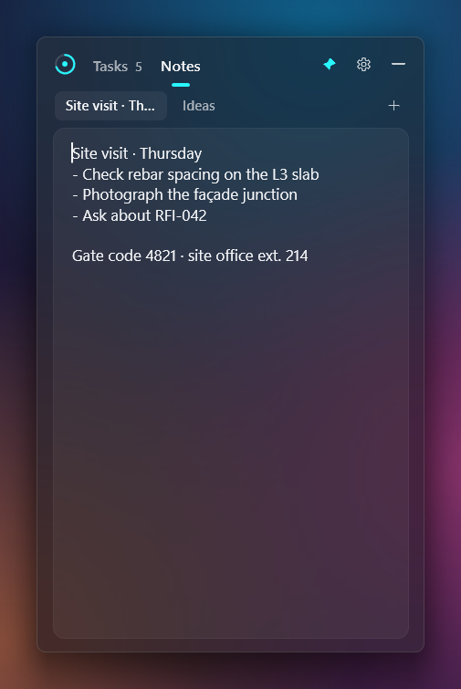
</p>
<p align="center">
  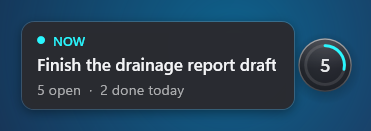
  &nbsp;
  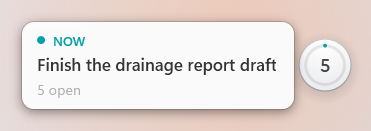<br/>
  <sub>Folded away, Tack is a small orb. Hover it to see what you're focusing on without opening anything.</sub>
</p>

---

When you work across many windows and monitors, it's easy to lose the thread. Most task apps make
you switch to them, navigate, and switch back. Tack stays on top of everything, takes almost no space,
and gets out of the way the moment you're done.

- **One orb, always on top.** Tack folds into a small glass orb you can drag anywhere. It snaps neatly
  to screen edges, never takes focus from the app you're in, and shows today's progress as a ring.
- **Peek without opening.** Hover the orb to see your current focus ("Now") and what's left.
- **Open in a click or a keystroke.** Click the orb or press **Ctrl+Alt+Space** from any app. Type a task,
  press Enter, press Esc, and you're back at work.
- **One task in focus.** Mark one task as *Now* and it gets pride of place at the top (and in the peek).
  No tags, priorities or due dates.
- **Spaces, if you want them.** Keep work, development and personal tasks apart: make a space in
  Settings and a slim strip under the header switches between them (Alt+1 to Alt+9, Alt+0 for all).
  Until you make one, there's nothing extra on screen.
- **Notes like scrap paper.** Plain-text sheets that save as you type. Lists continue themselves,
  F5 stamps the time, and Ctrl+Enter turns a line into a task. Paste a screenshot to keep it on the
  sheet while you follow it, then throw it away.
- **Find anything.** Ctrl+F searches every task, finished task and note in every space as you type,
  whatever the case or accents, and takes you straight to what you pick.
- **Drop it on the orb.** Drag an email from Outlook, a file or folder from Explorer, a link from your
  browser or a few lines of text onto the orb, and each becomes a task, without leaving the app you're in.
  A small paperclip on the task opens what you dropped.
- **A launcher, if you want one.** Turn it on in Settings → Launcher, then Shift+click the orb for a ring
  of your own shortcuts (apps, folders, websites, groups), or Shift+drag to one and let go. Drag on past an
  app to choose the display it opens on. Turn on **Recent files** and resting on an app shows the files it
  opened last (from its Jump List, or Revit's, AutoCAD's and Navisworks' own lists), to open one with that app.
  It's off by default, and while it's off nothing changes.
- **Windows 11 glass, light or dark.** Native acrylic, rounded corners, your accent colour, smooth and
  short animations. Follows Windows' light/dark mode, or pick one. Crisp on every monitor, at any scaling.
  Make the background more solid or more see-through, and, if you like, have Tack fade back while you
  aren't pointing at it.
- **Sized to fit.** The Tasks panel grows and shrinks with your list (then scrolls), Notes keeps its own
  size, and any size you drag to is remembered per tab. Switching tabs never makes the panel jump.
- **Polite.** Steps aside while a full-screen video, game or slideshow is in front.
- **On your phone too.** [Tack Focus](#tack-focus-tack-on-your-phone) puts the same tasks, notes and spaces
  on iPhone and Android, and the two keep in step through your own OneDrive. Search works there too, and
  on Android you can share a page, a link or some text to Tack from any app.
- **Yours.** No account, no telemetry, and Tack never connects to anything. Your tasks and notes are one
  readable JSON file; snippets and what you drop onto the orb stay on the PC beside it. Sync, if you turn it
  on, goes through your own OneDrive folder.

## Download

Grab the latest `Tack-x.y.z-win-x64.zip` from [**Releases**](../../releases/latest), unzip it and run
`Tack.exe`. Nothing to install, and no .NET runtime needed.

**Rather install it?** `Tack-x.y.z-setup.exe` from the same release installs that same Tack.exe with a
Start menu entry (a desktop one if you tick it) and an entry in **Settings → Apps** to uninstall it.
It asks first whether to install for everyone, in `C:\Program Files\Tack` (needs an administrator), or
just for you, in `%LOCALAPPDATA%\Programs\Tack` (no administrator). Running a newer setup upgrades it in
place, closing Tack first and starting it again. Either way your tasks stay in `%LOCALAPPDATA%\Tack`,
exactly as with the zip, so you can switch between the two; uninstalling leaves them there too (and
removes *Start with Windows* only if it pointed at the installed Tack). For IT: `/ALLUSERS` or
`/CURRENTUSER`, with `/VERYSILENT` for a silent install, and `/MERGETASKS=desktopicon` for the desktop
shortcut.

- Windows 10 or 11, x64 (developed and tested on Windows 11). Frosted glass needs Windows 11 22H2 or
  later; elsewhere the panel is solid.
- The exe isn't code-signed yet, so Windows SmartScreen may warn on first launch:
  choose **More info → Run anyway**.
- Already have the [.NET 8 Desktop Runtime](https://dotnet.microsoft.com/download/dotnet/8.0)?
  The `-net8.zip` download is under 1 MB.

To start Tack with Windows, turn on **Settings → Start with Windows**.

On a phone? Tack Focus needs no download: open [tackfocus.app](https://tackfocus.app) and add it to your
home screen. What's new: [CHANGELOG.md](CHANGELOG.md) (Tack), [web/CHANGELOG.md](web/CHANGELOG.md) (Tack Focus).

## Using Tack

| | |
|---|---|
| **Open / fold** | Click the orb, or press **Ctrl+Alt+Space** anywhere. **Esc** folds it back. |
| **Move** | Drag the orb, or drag the panel by its header. The orb follows the panel's nearest corner. |
| **Resize** | Drag the panel's edges. Each tab remembers its own size; until you resize Tasks, it fits its list. Double-click the header to go back to automatic sizing. |
| **Theme** | **Settings → Look**: System (follows Windows), Light or Dark. |
| **Background** | **Settings → Look → Panel background**: from solid to see-through (only the background; text stays crisp). The tick is the default. |
| **Fade when idle** | **Settings → Look** (off by default): the orb and a pinned panel fade to half when the pointer's been away a few seconds, and come back when you point at them. |
| **Sync** | **Settings → Sync → Turn on sync** keeps Tack in step with [Tack Focus](web/README.md) through your OneDrive (see below). |
| **Import** | **Settings → Import** merges a tack.json from [Tack Focus](web/README.md) (its Settings → Export), another PC or a backup. Undo puts it back. |
| **Pin** | 📌 keeps the panel open over other apps. Unpinned, it folds away when you click elsewhere. |
| **Orb menu** | Right-click the orb for Open, Settings and Quit. |

If another app already uses Ctrl+Alt+Space, Tack picks a free fallback on first run (Win+Ctrl+T,
Win+Alt+N, then Ctrl+Alt+Shift+T) and the welcome tasks tell you which. You can change it in
**Settings → Shortcut**.

### Tasks

- Type in **Add a task** and press **Enter**. **Ctrl+Enter** adds it *and* makes it your focus.
- Paste a list (bullets and numbering are stripped) to add many tasks at once.
- Click any task to edit it in place. Hover for **◎ focus** and **× delete**; right-click for more.
- Tick the circle to finish a task. You have a moment to change your mind before it moves to **Done**.
- Drag the dots at a task's left edge to reorder.
- Deleting is undoable: every delete shows an **Undo** button.

### Dropping onto the orb

Drag something over the orb and it lights up with a **+** and says what letting go will do ("Drop to add
a task"). Let go and each item becomes a task in the space on show, first item on top, with **Undo** in a
small bubble beside the orb ("Added 3 tasks · Undo"). Up to 20 at a time.

| You drop | The task is called | Its paperclip opens |
|---|---|---|
| A file or folder (Explorer, the desktop, most apps) | The file's name without its extension ("Clash report L3") | The file or folder, where it is |
| An email from Outlook | The email's subject | Tack's own copy of the email, kept in `attachments` beside tack.json |
| A link from a browser | The page's title, else the address | The page, in your default browser (http and https only) |
| Text | One task a line, as when you paste a list | (nothing) |

- Click the **paperclip** on a task (or press **Ctrl+O** on it, or right-click → Open) to open it. If a
  file was moved or deleted since, Tack says so.
- What a task points to stays on this PC: other devices see the task's text, never the path or link.
- Delete the task (once its Undo is gone) and Tack lets go of it, and of any email it kept a copy of.
- Programs and scripts are never kept, only their names. Tack keeps at most 500 MB of copies (50 MB each).

### Spaces

Everything starts in **Main**. To keep work, development and personal tasks apart, add a space in
**Settings → Spaces → + New space** (rename Main there too, say to "Work"). Spaces are optional:
until there's a second one, Tack looks exactly as it always has.

<p align="center">
  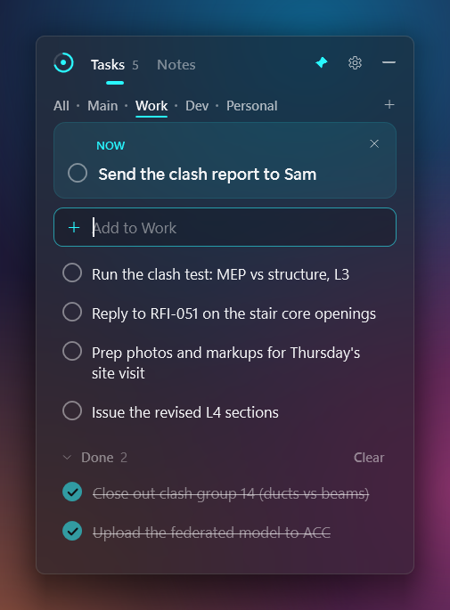
  &nbsp;
  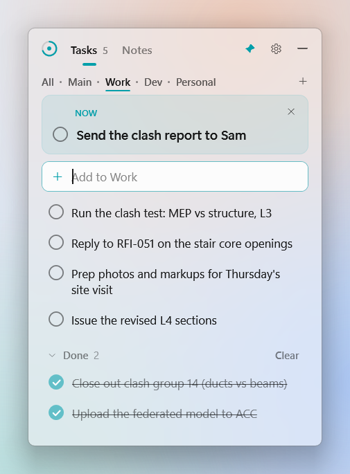
</p>

- Once there's a second space, a slim strip under the header lists **All · Main · Work · …**. Click one
  (or press **Alt+1** to **Alt+9** for the spaces in order, **Alt+0** for All) to show it. The keys work
  even while you're typing a task, and the draft stays. **+** at the end of the strip makes a space.
- A space shows its own tasks and sheets, in the one order you set. New tasks and sheets go into the
  space on show ("Add to Work"); from All, into Main. **All** shows everything, each task with its space.
- Right-click a task (or a sheet's name) → **Move to ▸** to put it in another space, or press **Ctrl+M**
  on a task. Undo moves it back.
- There's still one task in focus. In other spaces it shows as a slim line, "Now in Work: …"; click it
  to go there.
- Done, Clear, the orb's count and ring, and the peek ("Work · 3 open · 2 done today") are per space.
- **Settings → Spaces** renames, reorders and deletes spaces. Deleting one puts its tasks and notes
  back in Main (Undo brings the space back). Main can be renamed, never deleted.
- Each device remembers which space it shows; spaces themselves sync with Tack Focus.

### Notes

- Sheets are plain text; a sheet's title is its first line. **+** (or **Ctrl+N**) adds a sheet;
  right-click a sheet's name to delete it (or, with spaces, move it to another).
- Start a line with `- `, `* `, `1. ` or `[ ] ` and Enter continues the list.
- **Snippets.** Snip some instructions (Win+Shift+S), press **Ctrl+V** in a sheet, and the picture sits
  above the sheet's text as a thumbnail. Click it to see it full size on that display (Esc or a click
  closes it); **×** throws it away, with Undo. Image files copied in Explorer paste the same way, and an
  image pasted on Tasks goes to the sheet in Notes. Anything copied with text in it (cells from Excel,
  say) pastes as text, as before. Snippets stay on this PC: other devices show the sheet's text only.
  Tack keeps up to 50 of them (50 MB), scales very large images down, and deleting a sheet deletes its
  snippets.

### Search

Press **Ctrl+F** in the panel and type. A box takes the place of the tabs (nothing else moves), and
what matches is listed below it as you type: open tasks (the one in focus first), finished tasks and
notes, from every space, each with its space while there are spaces.

- Case and accents don't matter ("cafe" finds "Café", "strasse" finds "Straße"), nor do curly quotes,
  dashes or the odd non-breaking space pasted from an email. A note matches anywhere in it.
- **↑ / ↓** choose, **Enter** (or a click) goes there: to its space and tab, with the task scrolled to
  and lit up for a moment (the caret in it), or the sheet open with the match selected. A finished task
  opens Done.
- **Esc** closes search and puts the caret back where it was. Ctrl+F again brings back your last search.

### Launcher

Off by default. Turn it on in **Settings → Launcher** and fill its six positions with apps, folders,
websites or groups of up to eight. Then **Shift+click** the orb for the ring, or **Shift+drag** to a
shortcut and let go. Plain clicks and drags of the orb are untouched. More: [docs/LAUNCHER.md](docs/LAUNCHER.md).

**Recent files** (also off by default: **Settings → Launcher → Recent files**). Rest on an app for a moment
and the files it opened last fan out beside it, up to 8 that are still there; drag onto one and let go (or
click it) and it opens with that very app, on the display the shortcut uses. So a Revit 2024 model opens in
Revit 2024 even where .rvt files open in another version. The files come from the app's Jump List, then
Revit's, AutoCAD's and Navisworks' own recent lists; they're read as the launcher opens and never stored.
Dragging on past the app without stopping still chooses a display.

<p align="center">
  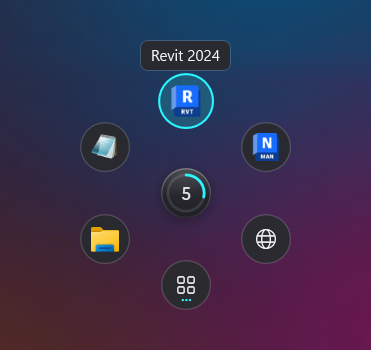
  &nbsp;
  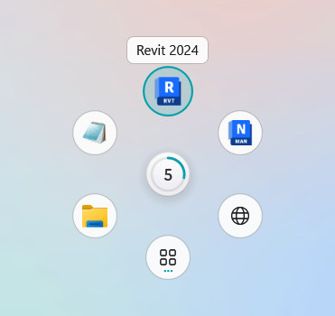<br/>
  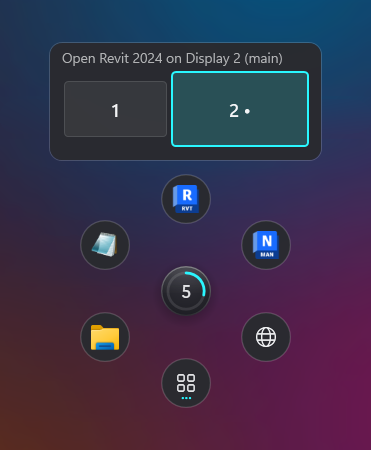<br/>
  <sub>Drag on past an app or folder and a map of your displays appears: let go on one to open it there
  (best effort: some apps put themselves back).</sub>
</p>

### Keyboard

| Keys | Where | Does |
|---|---|---|
| Ctrl+Alt+Space | Anywhere | Open Tack / fold it away |
| Esc | Panel | Cancel the current edit or close Settings, then fold away |
| Ctrl+1 / Ctrl+2 | Panel | Tasks / Notes |
| Ctrl+, | Panel | Settings |
| Ctrl+F | Panel | Search tasks, finished tasks and notes in every space |
| ↑ / ↓, Enter, Esc | Search | Choose a result, go to it, close search |
| Ctrl+Z | Panel | Undo the last delete, move, clear or paste |
| Enter / Ctrl+Enter | Add box | Add task / add and focus on it |
| ↑ / ↓ | Tasks | Move between tasks |
| Ctrl+Enter | A task | Make it the focus |
| Ctrl+D | A task | Mark done |
| Alt+↑ / Alt+↓ | A task | Move it up or down |
| Ctrl+M | A task | Move it to another space (once there are spaces) |
| Ctrl+O | A task | Open what was dropped onto the orb for it (its paperclip) |
| Backspace | An empty task | Delete it |
| Ctrl+Enter | Notes | Send the current line (or selection) to Tasks |
| F5 | Notes | Insert the date and time |
| Ctrl+V | Notes or Tasks | With an image copied (and no text): keep it on the sheet as a snippet |
| Esc, Enter or a click | A snippet, full size | Close it |
| Ctrl+N | Notes | New sheet |
| Ctrl+Tab / Ctrl+Shift+Tab | Notes | Next / previous sheet |
| Alt+1 … Alt+9 / Alt+0 | Panel | Show the 1st … 9th space / All (once there are spaces) |
| Drag and drop | The orb | Add a task for each file, folder, email, link or line of text (up to 20) |
| Shift+click / Shift+drag | The orb | Open the launcher / drag to a shortcut and let go (once it's on) |
| Arrows or Tab, Enter, 1–6 | Launcher | Move between shortcuts, open one, open a position |
| M or Shift+Enter, Esc | Launcher | Choose the display it opens on; step back, then close |
| R, then ↑ / ↓ and Enter | Launcher | Show the app's recent files, open one (once Recent files is on) |

## Your data

Everything lives in `%LOCALAPPDATA%\Tack\tack.json`: plain, indented JSON you can read, back up or
sync with whatever you like. Saves are debounced, written atomically (temp file, then replace), and the
previous version is kept as `tack.json.bak`, so a crash or power cut can't corrupt your list. If the file
is ever unreadable, Tack recovers from the backup and keeps the damaged file aside. With the launcher
on, its shortcuts are kept beside tack.json in `launcher.json` (never in tack.json, never synced).
Images pasted into Notes are PNG files in the `snippets` folder beside it, listed in `snippets.json`.
Once you drop something onto the orb, what each task points to is kept in `attachments.json`, and
emails in an `attachments` folder, beside tack.json. All of these stay on this PC: never in tack.json,
never synced, imported or exported.

The file also has a `tackFocus` section: a clock for every change, sort keys and recently deleted
items, so Tack can merge edits made elsewhere. Older versions of Tack ignore it. **Settings → Import**
brings in a tack.json exported from Tack Focus (or copied from another PC, or a backup): anything new
is added, where both changed the newer edit wins, a note written in both places is kept twice, and
Undo puts everything back.

**Sync (optional).** Turn on sync in Tack Focus first (it makes an "Apps › Tack Focus" folder in your
OneDrive); once the OneDrive app has brought that folder to your PC, **Settings → Sync → Turn on sync**
here finds it by itself. From then on the two keep each other up to date: Tack writes its own file in
that folder and reads the other devices' files, and the OneDrive app carries them. Tack itself still
never goes online, works fully offline, and keeps everything here if you turn sync off. Your tasks and
notes are stored in OneDrive as ordinary files, not end-to-end encrypted yet. How it works, and what's
verified: [docs/SYNC.md](docs/SYNC.md).

**Portable mode:** create a folder named `TackData` next to `Tack.exe` and Tack keeps everything there
instead, which is handy on a USB stick. (Like any single-file .NET app, the portable exe unpacks about 8 MB
of native WPF libraries into `%TEMP%\.net\Tack` on first launch; it's safe to delete.)

## Tack Focus: Tack on your phone

**[tackfocus.app](https://tackfocus.app)** is Tack's tasks, notes and spaces as an installable web app for
iPhone, Android and any browser. Open it and add it to your home screen; there's nothing to download. It
works offline, keeps everything on the device, and new versions arrive by themselves when you open it.
Search (the button beside Settings on a phone, or Ctrl+F) finds exactly what it finds on the PC. On
Android, an installed Tack Focus is in the share sheet: share a page, a link or some text from any app
and tap Add, and it's a task, with Undo. Turn on sync in both apps and they keep each other up to date through
a folder in your own OneDrive, with no Tack account and no Tack server. On iPhone and in Firefox,
staying signed in takes a quick visit to Microsoft about once a day as the app opens; if that's slow,
Tack says "Renewing your OneDrive sign-in…" and lets you open it anyway. Privacy, in plain words:
[tackfocus.app/privacy](https://tackfocus.app/privacy/). The code is in [`web/`](web/README.md).

## Lightweight by design

Measured on Windows 11 with the portable build:

| | |
|---|---|
| Startup to orb on screen | ~0.4 s normally; a few seconds on the very first launch (one-time unpacking) |
| CPU while idle | 0%: no timers or polling. Everything is event-driven |
| Memory when folded and idle | ~2–5 MB working set (Tack hands unused memory back to Windows); ~50 MB committed. The same with the launcher on |
| Download | ~56 MB zip (one self-contained exe) |

## Build from source

Requires Windows and the [.NET 8 SDK](https://dotnet.microsoft.com/download/dotnet/8.0).

```powershell
dotnet run --project src/Tack                     # run in debug
./build.ps1 -Version 1.0.0                        # release zips (and installer, with Inno Setup 6) in ./artifacts
cd web; npm install; npm run dev                  # Tack Focus at http://localhost:5173 (Node 22)
```

Pushing a tag like `v1.0.0` runs [`release.yml`](.github/workflows/release.yml), which builds the downloads
and publishes a GitHub Release. Tack Focus deploys to tackfocus.app on merge ([web/DEPLOY.md](web/DEPLOY.md)).
See [CONTRIBUTING.md](CONTRIBUTING.md) for the project layout, and [docs/DESIGN.md](docs/DESIGN.md) for the
thinking behind the design.

## License

[MIT](LICENSE). Free forever: no ads, no accounts, no telemetry, no paid tier.
